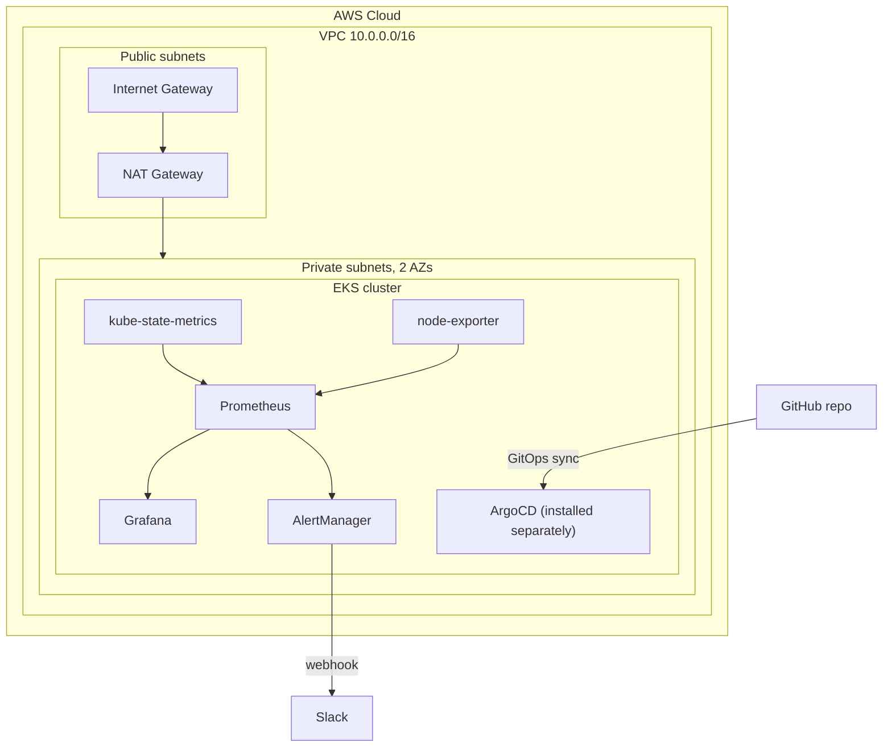

# Terraform AWS EKS Monitoring Stack

Infrastructure as Code for a Kubernetes cluster on AWS EKS with Prometheus, Grafana, AlertManager and GitOps delivery via ArgoCD.


This cluster is built to be stood up, worked with, and destroyed the same weekend. Several choices are deliberately cheaper and simpler than production would be, and each one is written down in [docs/decisions.md](docs/decisions.md) with what production does instead.

**It bills by the hour while it runs.** Read [docs/cost.md](docs/cost.md) before the first apply and tear it down with `scripts/destroy.sh`.

**Status:** Applied to a live EKS cluster on 2026-10-28 (2 x t3.small, us-east-1) and torn down the same evening. All ten scrape targets were up, a crashing pod fired `PodCrashLooping`, a node with its kubelet stopped fired `NodeNotReady`, and both alerts reached Alertmanager. That run found the Grafana memory limit, crash-loop rule and upgrade policy problems fixed since. Those fixes pass `terraform validate` and parse, but have not been through a second live run yet.

## Architecture



The control plane is not in the diagram because AWS runs it. You never see those instances and cannot reach them over SSH, which is the difference between EKS and running Kubernetes yourself with kubeadm or kops.

## Tech stack

| Component | Technology | Purpose |
|---|---|---|
| Infrastructure | Terraform v1.5+ | Provision VPC, EKS cluster, networking |
| Cloud | AWS EKS, VPC, EC2, IAM | Managed Kubernetes control plane |
| Metrics | Prometheus 3.x | Cluster and application metrics |
| Cluster state | kube-state-metrics | Pod, node and workload object metrics |
| Host metrics | node-exporter | Per-node CPU, memory, disk and network |
| Visualization | Grafana | Explore queries against Prometheus |
| Alerting | AlertManager | Routes alerts to Slack |
| GitOps | ArgoCD | Syncs the cluster from Git |

## Alerts

| Alert | Condition | Severity | Metrics from |
|---|---|---|---|
| Node Not Ready | Node status not Ready for 5m | Critical | kube-state-metrics |
| High CPU Usage | Node CPU above 80% for 10m | Warning | node-exporter |
| High Memory Usage | Node memory above 85% for 10m | Warning | node-exporter |
| Pod Crash Looping | Container in CrashLoopBackOff for 5m | Critical | kube-state-metrics |
| Persistent Volume Full | PV usage above 90% | Warning | kubelet |

Both exporters are deployed, so the first four rules have a live source. `Persistent Volume Full` is wired correctly but returns nothing until some workload claims a volume, and nothing in this stack does, since all storage is `emptyDir`.

That distinction is the point of the last column. An alert whose metrics are missing never fires while the dashboard still looks healthy, which is worse than having no alert at all.

## Prerequisites

- [Terraform](https://www.terraform.io/downloads) >= 1.5.0
- [AWS CLI](https://aws.amazon.com/cli/) configured with credentials
- [kubectl](https://kubernetes.io/docs/tasks/tools/) >= 1.34
- [ArgoCD CLI](https://argo-cd.readthedocs.io/en/stable/cli_installation/), optional
- An AWS account with permissions for EKS, VPC, IAM and EC2, and a billing alarm set

## Quick start

### 1. Clone

```bash
git clone https://github.com/khadirullah/terraform-eks-monitoring.git
cd terraform-eks-monitoring
```

### 2. Configure

```bash
cp terraform/terraform.tfvars.example terraform/terraform.tfvars
curl -s https://checkip.amazonaws.com    # your public IP
```

Set `public_access_cidrs` to that address as a `/32`. Left at the default the Kubernetes API endpoint is reachable from anywhere. It still requires IAM authentication, so this is unnecessary exposure rather than an open door.

### 3. Provision

```bash
cd terraform
terraform init
terraform plan -out=tfplan
terraform apply tfplan
```

No `-auto-approve` here on purpose. Read the plan. This step creates the resources that cost money.

```bash
aws eks update-kubeconfig --region ap-south-1 --name eks-monitoring
```

### 4. Deploy the monitoring stack

```bash
kubectl apply -f k8s/monitoring/namespace.yaml
kubectl apply -f k8s/monitoring/
kubectl get pods -n monitoring
```

The namespace goes first on its own line. kubectl applies a directory in file name order, and `alertmanager-deployment.yaml` sorts before `namespace.yaml`.

### 5. Reach the UIs

```bash
kubectl port-forward -n monitoring svc/grafana      3000:3000
kubectl port-forward -n monitoring svc/prometheus   9090:9090
kubectl port-forward -n monitoring svc/alertmanager 9093:9093
```

Grafana's admin password comes from a Secret, not from a default:

```bash
kubectl get secret -n monitoring grafana-admin \
  -o jsonpath='{.data.admin-password}' | base64 -d
```

### 6. ArgoCD, optional

```bash
kubectl create namespace argocd
kubectl apply -n argocd -f https://raw.githubusercontent.com/argoproj/argo-cd/stable/manifests/install.yaml
kubectl apply -f k8s/argocd/application.yaml
```

### Or use the scripts

```bash
./scripts/deploy.sh     # plans, shows the cost, asks before creating anything
./scripts/destroy.sh    # tears it all down and checks nothing was left billing
```

## Cleanup

```bash
./scripts/destroy.sh
```

Not a bare `terraform destroy`. Kubernetes Services of type LoadBalancer create ELBs that Terraform never made and knows nothing about. Destroy the VPC with one still live and the delete hangs on subnets that will not release while the ELB keeps charging. The script removes those first, then destroys, then sweeps for orphaned load balancers, unattached Elastic IPs and stray volumes.

## Key design decisions

Worker nodes sit in private subnets with NAT egress. Only the API endpoint is public, and it is CIDR restricted.

Managed node groups rather than self-managed, so AMI updates and lifecycle are AWS's problem.

Prometheus rather than CloudWatch. PromQL and the exporter ecosystem move between clouds. CloudWatch does not.

GitOps with ArgoCD. Cluster state comes from a Git commit rather than from whoever last ran `kubectl apply`. ArgoCD watches the repo and syncs the difference.

AlertManager routes to Slack. Critical alerts go to their own channel, warnings to another, and an inhibit rule suppresses the warning when the critical for the same node is already firing.

Raw `aws_*` resources rather than the community EKS module, and hand-written manifests rather than the kube-prometheus-stack chart. Both are more code. Both make every IAM role, route table and scrape job visible instead of hidden behind a module you never read.

IRSA is wired up, so a service account can assume its own IAM role instead of sharing the credentials every pod on the node already has.

The full reasoning for each, with the alternative it beat, is in [docs/decisions.md](docs/decisions.md).

## What is deliberately missing

No persistent volumes. Prometheus and Grafana write to `emptyDir`, so metrics and dashboards are lost when a pod restarts. Production attaches EBS through the CSI driver.

One NAT gateway, not one per availability zone. Cheaper, and a single point of failure for outbound traffic.

Local Terraform state, no S3 backend and no locking. Fine for one person, wrong for a team.

No ingress and no load balancers. Grafana, Prometheus and Alertmanager are reached with `port-forward`.

No provisioned dashboards. Grafana starts with the Prometheus data source wired up and an empty dashboard list, so graphs come from Explore. Importing a community dashboard such as Node Exporter Full (ID 1860) takes a minute, but it lives in `emptyDir` and is gone after the next pod restart.

## Layout

```
terraform-eks-monitoring/
├── terraform/
│   ├── providers.tf              # AWS and TLS providers, version constraints
│   ├── variables.tf              # inputs, cluster_version and public_access_cidrs
│   ├── vpc.tf                    # VPC, subnets, NAT gateway, route tables
│   ├── eks.tf                    # cluster, IAM roles, node group, managed addons
│   ├── irsa.tf                   # OIDC provider for IAM Roles for Service Accounts
│   ├── outputs.tf                # endpoint, OIDC issuer, kubeconfig command
│   ├── terraform.tfvars.example  # example values
│   └── .terraform.lock.hcl       # tracked, pins provider versions
├── k8s/
│   ├── monitoring/
│   │   ├── namespace.yaml
│   │   ├── prometheus-config.yaml       # scrape jobs and alert rules
│   │   ├── prometheus-deployment.yaml
│   │   ├── kube-state-metrics.yaml      # workload object metrics
│   │   ├── node-exporter.yaml           # DaemonSet, per-node host metrics
│   │   ├── grafana-deployment.yaml
│   │   └── alertmanager-deployment.yaml
│   └── argocd/
│       └── application.yaml
├── scripts/
│   ├── deploy.sh
│   └── destroy.sh
├── docs/
│   ├── decisions.md              # every choice and the alternative it beat
│   ├── runbook.md                # the commands, in order, plus upgrades
│   └── cost.md                   # what bills and how not to be surprised
├── .gitignore
├── LICENSE
└── README.md
```

## License

MIT, see [LICENSE](LICENSE).

## Author

**Khadirullah Mohammad** — [khadirullah.com](https://khadirullah.com) | [LinkedIn](https://linkedin.com/in/khadirullah) | [GitHub](https://github.com/khadirullah)
