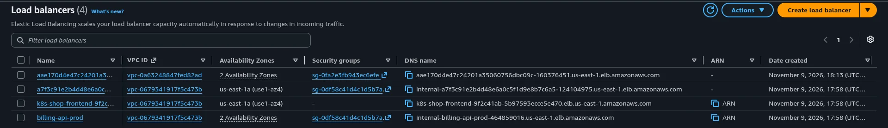
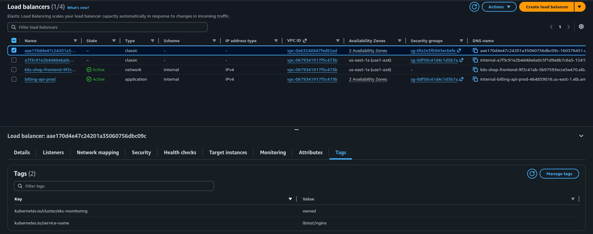
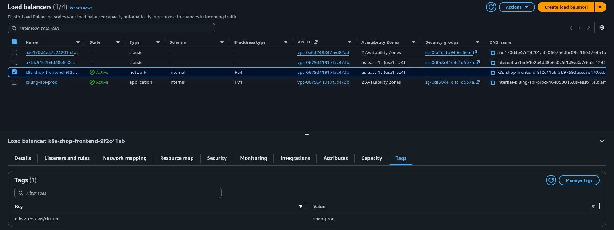
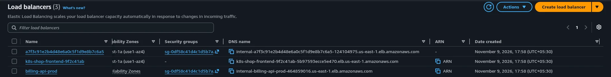

# Run 3, 2026-11-09

This run tested one question. If the account already has load balancers from
other projects, does `scripts/destroy.sh` leave them alone?

Logs are in [logs/run-3/](logs/run-3/), numbered in the order they happened.
Times are UTC.

## Why it matters

A Service of `type: LoadBalancer` makes Kubernetes ask AWS for a load balancer.
Terraform never sees that request, so the load balancer is not in its state. It
sits in the cluster's subnets and stops the VPC from deleting. So `destroy.sh`
deletes those Services first, and after `terraform destroy` it checks that no
load balancer was left behind.

That last check used to match "k8s" in the names of newer load balancers and
list every classic load balancer in the region. That misses a leftover named
the way EKS names them, with a random hash, and it reports load balancers that
belong to someone else. It now asks AWS for load balancers tagged
`kubernetes.io/cluster/<cluster>` or `elbv2.k8s.aws/cluster=<cluster>`.

## What I did

1. **12:28.** Before the cluster existed, I made three internal load balancers
   in the default VPC to stand in for other projects
   ([01](logs/run-3/01-other-project-lbs-create.log)):

   | Name | Type | Tag |
   |---|---|---|
   | `a7f3c91e2b4d48e6a0c5f1d9e8b7c6a5` | classic | `Project=payments-legacy` |
   | `k8s-shop-frontend-9f2c41ab` | network | `elbv2.k8s.aws/cluster=shop-prod` |
   | `billing-api-prod` | application | `Project=billing` |

   The first has a name like the ones EKS gives its own. The second has "k8s"
   in its name and a cluster tag, but for a different cluster.

2. **`deploy.sh`.** 28 resources, the control plane in 10 minutes 34 seconds,
   all monitoring pods ready ([02](logs/run-3/02-deploy.log)).

3. **12:43.** I applied [nginx-lb.yaml](logs/run-3/nginx-lb.yaml), a
   `type: LoadBalancer` Service. Kubernetes made a classic load balancer named
   `aae170d4e47c24201a35060756dbc09c` in the cluster's VPC
   ([03](logs/run-3/03-nginx-lb.log)). AWS gave it these tags
   ([04](logs/run-3/04-before-destroy.log)):

   ```text
   kubernetes.io/service-name           lbtest/nginx
   kubernetes.io/cluster/eks-monitoring owned
   ```

   

   

   

4. **`destroy.sh`** ([05](logs/run-3/05-destroy.log)):

   ```text
   [->] Step 1/3: Removing Kubernetes resources that hold AWS load balancers
   [!] LoadBalancer services found, deleting them first:
   lbtest/nginx
   ...
   Destroy complete! Resources: 28 destroyed.
   ...
   [->] Step 3/3: Checking for orphaned resources that still cost money
   [ok] Nothing orphaned in us-east-1.
   ```

5. **13:02.** The load balancers left in the region
   ([06](logs/run-3/06-after-destroy.log)):

   ```text
   a7f3c91e2b4d48e6a0c5f1d9e8b7c6a5	classic	vpc-0679341917f5c473b
   k8s-shop-frontend-9f2c41ab	network	vpc-0679341917f5c473b	active
   billing-api-prod	application	vpc-0679341917f5c473b	active
   ```

   

6. I removed the cluster from my kubeconfig with the three commands in the
   runbook ([07](logs/run-3/07-kubeconfig-cleanup.log)), then deleted the three
   test load balancers and checked the region was empty
   ([08](logs/run-3/08-cleanup.log)).

## What I saw

- **Kubernetes tags its load balancer with the cluster name.** That is the tag
  the check now looks for.
- **Step 1 removed only the nginx load balancer.** It works through Kubernetes,
  so it never sees load balancers Kubernetes did not make.
- **`terraform destroy` finished.** The VPC deleted cleanly because the nginx
  load balancer was already gone.
- **Step 3 named none of the other three.** That includes the one with "k8s" in
  its name and the one tagged for another cluster.

## Checks before this run

Two smaller tests of the new step 3, without a cluster:

- **Two tagged load balancers.** I made a classic one tagged
  `kubernetes.io/cluster/eks-monitoring` and a network one tagged
  `elbv2.k8s.aws/cluster=eks-monitoring`, named without "k8s". The new check
  listed both. The old one listed only the classic one, because it listed every
  classic load balancer, and missed the network one.
- **A key AWS rejects.** The new check reported all three checks as not run and
  exited 1. The old one printed `Nothing orphaned` and exited 0.

## What this run does not cover

A load balancer made by hand inside the cluster's VPC, with no Kubernetes tag.
Step 1 cannot see it and step 3 does not look for it, so `terraform destroy`
would stall on the VPC. Delete anything like that before running `destroy.sh`.
